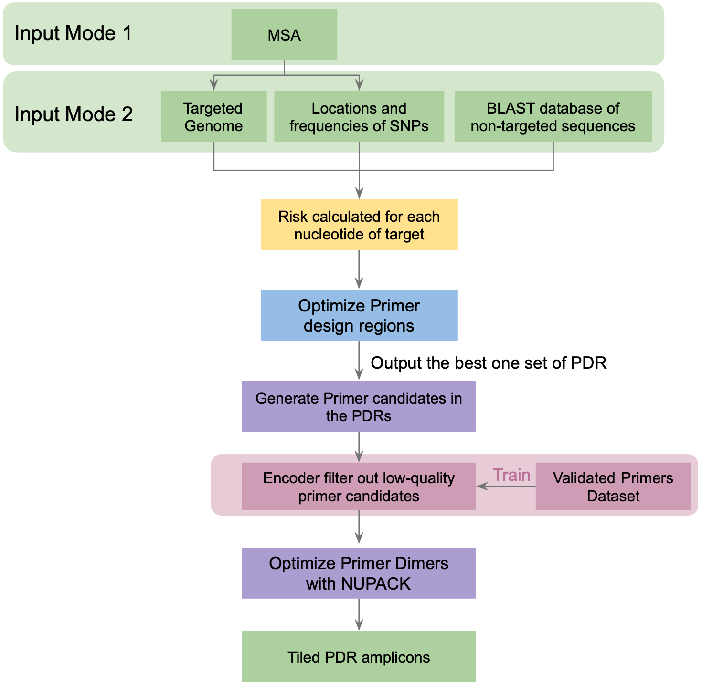
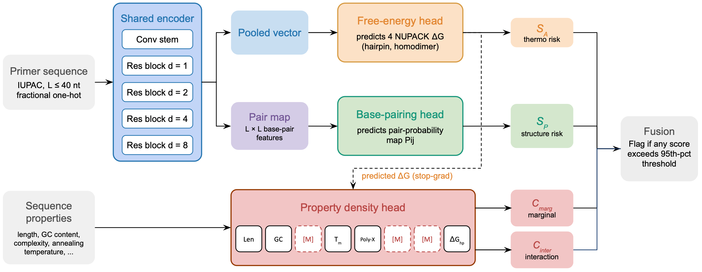

# Olivia
> Li D., Wang M.X., Stadler L.B., Treangen T.J. *Olivia: Learned Sequence
> Representations Enable Automated Primer Design for Multiplex Tiled Amplicon
> Sequencing.*

<p align="center">
  
</p>

Olivia designs tiled amplicon primer schemes from a multiple sequence alignment
(MSA). It extends [Olivar](https://github.com/treangenlab/Olivar) with:

- **An encoder trained on ~1 million published primers.** Every primer candidate
  is scored by a multi-head encoder trained on experimentally validated
  primers from more than 8,000 species. The more abnormal half is discarded
  before primer-dimer optimization.
- **NUPACK primer-dimer optimization.** Pools are optimized against NUPACK 4
  free energies instead of Olivar's SADDLE heuristic.
- **Degenerate primers.** In degenerate mode the design reference is an IUPAC
  consensus of the MSA, so primers can cover sequence variation with ambiguous
  bases.

## Installation

**Requirements:** Linux (x86-64; tested), [conda](https://docs.conda.io/en/latest/miniconda.html)
or mamba. A GPU is optional; on CPU the encoder scores about 60 primers per second.

### 1. Download Olivia

```bash
git clone https://github.com/treangenlab/Olivia.git
cd Olivia
```
The repository includes the trained encoder (`results/encoder/encoder.pt`,
2.4 MB), so nothing else needs to be downloaded to design primers.

### 2. Create the conda environment

```bash
conda env create -f environment.yml
conda activate olivia
```

### 3. Install NUPACK 4

NUPACK cannot be redistributed by us, so it is installed from your own download:

1. Register and download **NUPACK 4.0.2.0** from <https://nupack.org>.
2. Unzip it and install the wheel:

   ```bash
   unzip nupack-4.0.2.0.zip
   pip install nupack -f nupack-4.0.2.0/package
   python -c "import nupack; print(nupack.__version__)"    # 4.0.2.0
   ```

### 4. Install Olivia

From the `Olivia` directory, with the `olivia` environment active:

```bash
pip install -e .
```

Use editable mode (`-e`): Olivia loads the encoder checkpoint from
`results/encoder/` inside this directory.

### 5. Check the installation

```bash
olivia --version                 # olivia v1.0.0
python -c "import olivia, encoder_filter; print(encoder_filter.EncoderScorer().score(['ACTACTGCCATTGAGCAGGC'])['A'])"
```

Then run the [Quick start](#quick-start) example (about 2 minutes on 16 threads).
The benchmark tools (Olivar, PrimalScheme3, varVAMP) have their own environments, described in [benchmark/README.md](benchmark/README.md).

## Quick start

Design a non-degenerate scheme from an MSA:

```bash
olivia build -m example/hepatitis_e_aln.fasta -o example/out/ref -p 16
olivia tiling example/out/ref/hepatitis_e_aln.olvr -o example/out/nondeg -p 16
```

Design with degenerate primers, as Olivia-deg in the paper:

```bash
olivia build -m example/hepatitis_e_aln.fasta --deg -o example/out/ref_deg -p 16
olivia tiling example/out/ref_deg/hepatitis_e_aln.olvr --deg --K 64 -o example/out/deg -p 16
```

`tiling` writes the following:

| File | Content |
|---|---|
| `olivia-design.csv` | amplicons with forward/reverse primers, pool and coordinates |
| `olivia-design.primer.bed` | primers in ARTIC BED format |
| `olivia-design.olvd` | full design, reloadable with `olivia save` |
| `*.html` | interactive risk, primer and optimization-loss plots |

A single-target design takes about 2 minutes (non-degenerate) to 4 minutes
(degenerate) on the 138-genome HEV example at 16 threads.

### Main options

| Option | Default | Meaning |
|---|---|---|
| `build --deg` | off | build an IUPAC consensus reference (MSA input only) |
| `build --cons-thres` | 0.7 | a column stays non-degenerate once its top base reaches this frequency |
| `tiling --deg` | off | design degenerate primers |
| `tiling --max-amp-len` | 420 | maximum amplicon length; minimum defaults to 90% of it |
| `tiling --keep-frac` | 0.5 | fraction of candidates kept per plex by the encoder; `1.0` disables it |
| `tiling --max-deg` | 128 | reject candidates expanding to more concrete sequences |
| `tiling --K` / `--deg-sample` | 0 | fold at most K expansion pairs per degenerate candidate pair (0 = all, exact); 64 is the paper setting |
| `tiling -p` | 1 | worker processes |

Run `olivia build --help` and `olivia tiling --help` for all options. The
`specificity` and `sensitivity` sub-commands are unchanged from Olivar.

### Python API

```python
from olivia import build, tiling
```

The arguments mirror the CLI; see the docstrings in `src/olivia/main.py`.

### Scoring primers with the encoder only

The encoder can be used as a stand-alone pre-filter for other design tools:

```python
import olivia, encoder_filter   # importing olivia puts encoder_filter on the path
scorer = encoder_filter.EncoderScorer(threads=8)
scores = scorer.score(["ACTACTGCCATTGAGCAGGC", "GGGGGGCCCCCCGGGGGGCCCC"])
# scores["A"], ["C_marg"], ["C_inter"], ["P"]: per-head risk, higher is worse
# scores["fused"]: max over heads after an empirical-CDF transform within this set
```

## Repository layout

```
olivia                      command-line interface
src/olivia/                 design engine
    encoder_filter.py         encoder scoring and candidate filtering
    nupack_helper.py          NUPACK free-energy evaluation
    pair_table.py             cached primer-pair deltaG table for pool optimization
    main.py, tiling_helper.py build / tiling workflow
src/olivia_encoder/         the encoder model
    encoder.py                network and the free-energy / pair-map heads
    density.py                property distribution head (C_marg, C_inter)
    properties.py             the primer properties
    sequence.py, data.py, targets.py, synergy.py
    train.py                  training
    prepare_primers.py, build_dataset.py, nupack_dump_sequences.py, nupack_targets.py
                              dataset preparation
data/                       training data (The literature-extracted primers)
results/encoder/            trained checkpoint (encoder.pt) and the paper's model results
analysis/                   model figures (classification, embedding, synergy, risk)
benchmark/                  12-virus benchmark against Olivar, PrimalScheme3, varVAMP
example/                    example inputs
```

## The encoder
<p align="center">
  
</p>

### Retraining

The training corpus (about 1.7 million primer records, 980,039 unique
sequences) is at <https://huggingface.co/datasets/dongwei2001/Olivia-training-data>. 

## Reproducing the paper

| Paper item | Script | Input shipped here |
|---|---|---|
| Fig. classification performance (precision/recall/F1/AUROC) | `analysis/plot_classification.py` | `results/encoder/fusion_f1.csv` |
| Supp. Fig. embedding separation (t-SNE, linear probe) | `analysis/embedding_separation.py` | needs evaluation corpora |
| Supp. Fig. mutual information (synergy surfaces) | `analysis/property_synergy.py` | `results/encoder/encoder.pt` |
| Fig. conditional risk curves | `analysis/property_synergy.py` | `results/encoder/encoder.pt` |
| Supp. Fig. property dependence matrix | written by `python -m olivia_encoder.train` | shipped as `results/encoder/property_dependence_matrix.*` |
| Fig. alignment entropy | `benchmark/primer_param_analysis.py` | needs target alignments |
| Fig. mismatches by position | `benchmark/mismatch_both_modes.py` | needs target alignments |
| Fig. degeneracy and mismatch summary | `benchmark/plot_mismatch_summary_both_modes.py`, `benchmark/compose_benchmark_figure.py` | `benchmark/output/mismatch_both_modes/summary.csv` |
| Fig. abnormality rates | `benchmark/plot_viral_benchmark_abnormality.py` | `benchmark/output/tables_viral_benchmark.tex` |
| Supp. tables mismatch / abnormality (published and degeneracy-matched) | `benchmark/make_compact_tables.py` | `benchmark/output/` |
| Supp. tables breadth / recovery | `benchmark/make_design_tables.py` | needs target alignments |

The pre-computed figures in `results/encoder/` are included. Every
primer scheme evaluated in the paper is in
`benchmark/output/<target>/designed_primers.csv`. See
[benchmark/README.md](benchmark/README.md) for rerunning the benchmark.

## License

GPL-3.0(see `LICENSE`). NUPACK is subject to its own license and must be obtained separately.

## Contact

Dongwei Li (dl82@rice.edu), Treangen Lab, Rice University. Please open a GitHub
issue for questions and bug reports.
